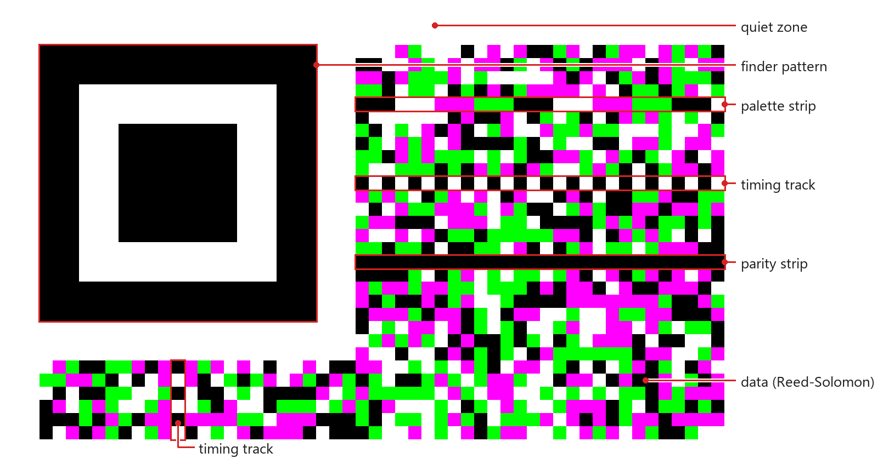
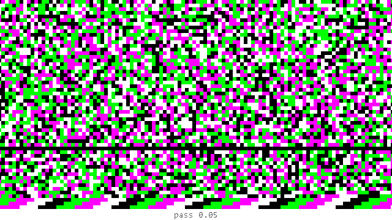

# QQR — visual file transfer

QQR moves a file from one computer to another through a screen and a phone camera, with no cable, network or
storage device. The sending PC shows the file as a stream of dense coloured frames; a phone films the screen; the
receiving PC decodes the video back into the original file and checks its SHA-256.

It handles anything from a few kilobytes (one photo of one frame is enough) to files of 1–2 GB (a video of a few
minutes to an hour, depending on the camera). One Windows executable, `vfdt.exe`, does both ends.


*One frame of a real 4K phone recording of the player. The squares in the corners are the finder patterns.*

## How it works



- **Frames:** each frame is a grid of cells in 4 colours (2 bits per cell) or 2 colours (1 bit), framed by finder
  patterns so the reader can find and unwarp the grid in a camera image. Alternating timing tracks pin down the grid
  size, and the palette strip shows each colour as the camera sees it. Parity strips turn black and white on
  alternate frames, so images caught mid-switch are recognised and skipped.
- **Inside a frame:** data is protected by Reed-Solomon RS(255,191) codewords, interleaved across the whole frame,
  so a smudge or a glare spot costs a few bytes in many codewords instead of whole codewords.
- **Across frames:** the file is cut into packets of a fountain code. The player loops forever with fresh repair
  packets, so a missed frame never has to be waited for again: any large enough set of packets rebuilds the file.
- **End to end:** the transfer carries a manifest with the file name, size and SHA-256; `decode` writes the file only
  when the hash matches.

## Requirements

- Windows 10 or later for `play` and `calibrate show` (the player uses the Win32 API). The other commands also build
  on other platforms.
- A C++20 compiler and CMake 3.20 or later (tested with Visual Studio 2022).
- FFmpeg (`ffmpeg` and `ffprobe`) to read phone videos and photos, either next to `vfdt.exe` or on `PATH`.
- A phone that records 4K at 60 fps gives the best results; 1080p or 30 fps works only with large cells.

The build needs no network: GoogleTest is vendored under `third_party/` (see `third_party/README`).

## Build

```text
cmake -S . -B build
cmake --build build --config Release
ctest --test-dir build -C Release
```

The program is `build/app/Release/vfdt.exe`.

## Use

### 1. Calibrate once per setup

```text
vfdt calibrate show
```

This cycles through every combination of cell size, colour count and frame rate (by default 7 sizes × 4 and 2
colours × 30 and 20 frames/s, 3 s each, 84 s per cycle). Mount the phone where it will stay, record one full cycle
plus a few seconds, then:

```text
vfdt calibrate check calib.mp4
```

It reports, for each combination, how much of the data was read and how many errors Reed-Solomon had to fix, and
recommends the fastest reliable one as a ready-to-run `play` command. Narrow or widen the sweep with lists, up to 32
combinations: `--cells 6,5,4,3 --colors 4,2 --fps 30,20,15`.

### 2. Send a file

```text
vfdt play <file> --cell 5 --colors 4 --fps 30
```

It prints the length of one pass. Start recording, press Space, and press Esc once the counter at the bottom of
the screen has passed 1.00 and about 10 s more have gone by.



*The bottom of the screen while playing. `pass` counts how much of one full pass has been shown; 1.00 is one pass.*

### 3. Receive it

```text
vfdt decode video.mp4 --colors 4 --out received
```

If blocks are still missing, play again, record another pass, and decode both videos together:
`vfdt decode video.mp4 video2.mp4 --out received`.

### Small files: one photo

```text
vfdt image small.txt
```

writes `small.txt.png`, which holds the whole file. Show it full screen at 100% zoom, take a photo, and run
`vfdt decode photo.jpg --out received`.

### Try it without a phone

`vfdt simulate <file>` and `vfdt calibrate simulate` send frames through a simulated camera with blur, noise, tilt,
dropped frames and rolling-shutter switching, and decode the result.

Run `vfdt help` for every command and option.

## Camera tips

- Record in 4K at 60 fps with the main 1× lens; phones often fall back to 1080p 30 fps. `decode` and
  `calibrate check` warn when a recording is below that.
- Use a tripod, turn stabilisation and HDR off, and lock focus and exposure on the screen.
- Let the screen fill 85–90% of the picture; turn screen brightness up, Night light off, and dim the room.

## Project layout

| Path | Contents |
|---|---|
| `include/`, `src/` | the library: frame layout, rendering and reading, Reed-Solomon, fountain code, manifest, player, video input, calibration, camera simulator |
| `app/` | the `vfdt` command line |
| `tests/` | GoogleTest suite, one file per module |
| `testcase/` | sample files and step-by-step phone tests (see `testcase/README.md`) |
| `docs/` | the pictures in this README |
| `third_party/` | vendored GoogleTest |
